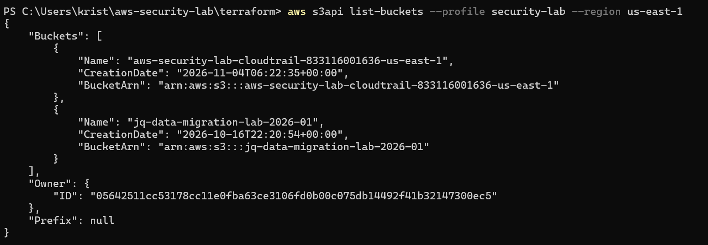
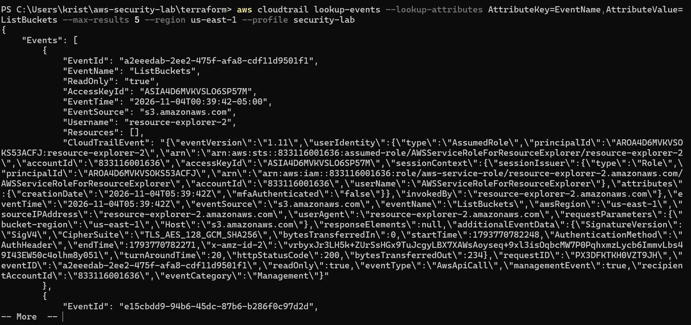
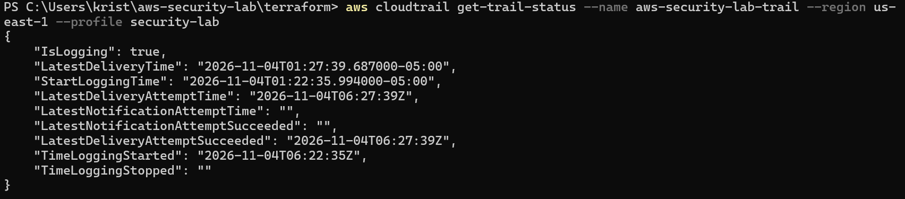
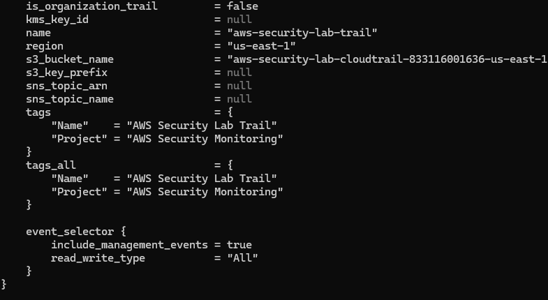
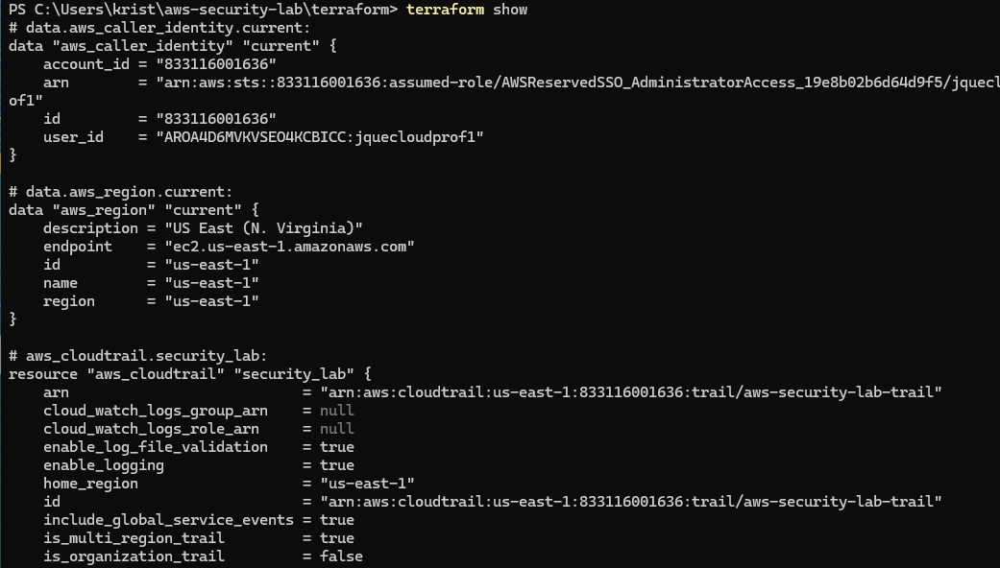
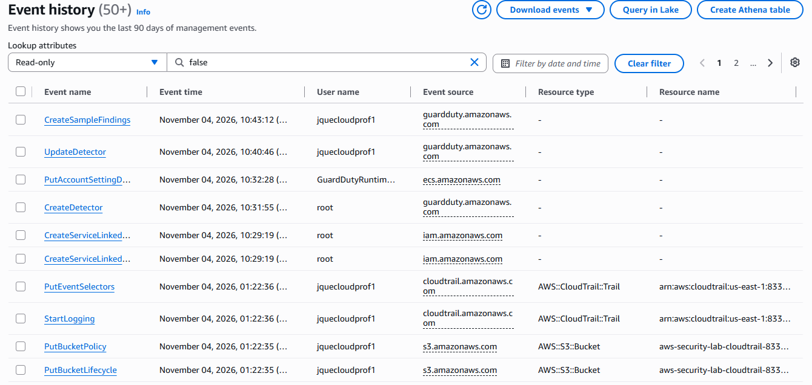
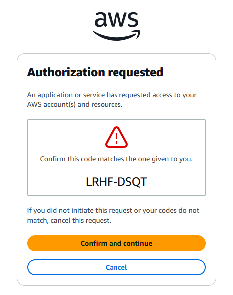
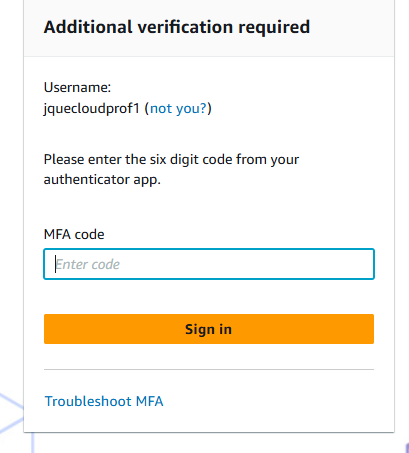

# AWS Security Monitoring and Incident Response

## Project Overview

This project demonstrates the implementation of AWS security monitoring and incident response capabilities using Terraform, AWS CLI, and the AWS Management Console.

The goal was to build practical experience monitoring AWS account activity, investigating security findings, reviewing network access controls, and documenting incident response procedures.

<h3>Security Issues & Risk Assessment</h3>

<p>
The initial AWS environment presented several security risks, including <strong>unrestricted outbound network traffic</strong>, potential <strong>EC2 security group misconfigurations</strong>, insufficient visibility into AWS account activity, and a lack of enforced <strong>Multi-Factor Authentication (MFA)</strong>. These weaknesses increased exposure to unauthorized access, credential compromise, unnecessary network exposure, and delayed threat detection.
</p>

<h3>Security Controls & Remediation</h3>

<p>
Reviewed EC2 security group rules, configured <strong>AWS IAM Identity Center MFA</strong>, deployed <strong>multi-region CloudTrail logging</strong>, centralized audit logs in <strong>Amazon S3</strong>, and enabled log file validation. Evaluated <strong>Amazon GuardDuty</strong> threat detection capabilities to improve security monitoring.
</p>

<h3>Investigation & Validation</h3>

<p>
Analyzed AWS management events using CloudTrail and AWS CLI, reviewed API activity and identity information, and investigated a <strong>synthetic GuardDuty finding</strong>. Verified log delivery across multiple AWS regions, assessed network access controls, and documented incident response recommendations.
</p>

<h3>Objectives</h3>
<hr>

<ul>
<li><strong>Network Security:</strong> Assess inbound and outbound traffic permissions.</li>
<li><strong>Identity Security:</strong> Reduce credential-based attacks through MFA enforcement.</li>
<li><strong>Threat Detection:</strong> Improve visibility into potentially malicious AWS activity.</li>
<li><strong>Log Integrity:</strong> Validate centralized audit logging and support forensic investigations.</li>
<li><strong>Incident Response:</strong> Develop investigation procedures and document remediation recommendations.</li>
<li><strong>Infrastructure Security:</strong> Use Terraform to deploy repeatable security monitoring infrastructure.</li>
</ul>

## Technologies Used

- Amazon Web Services (AWS)
- AWS CloudTrail
- Amazon GuardDuty
- AWS IAM Identity Center
- Amazon EC2 Security Groups
- Amazon S3
- Terraform
- AWS CLI
- Windows PowerShell
- Git and GitHub

## Project Objectives

- Deploy AWS security monitoring infrastructure using Terraform.
- Configure CloudTrail to record AWS management events.
- Store CloudTrail logs in an Amazon S3 bucket.
- Enable Amazon GuardDuty and review its security findings.
- Inspect EC2 security group inbound and outbound rules.
- Investigate AWS activity using CloudTrail Event History.
- Configure and verify multi-factor authentication through IAM Identity Center.
- Document security findings and incident response recommendations.

## Implementation

### 1. CloudTrail Configuration

- Created a multi-region CloudTrail trail using Terraform.
- Configured an S3 bucket for log storage.
- Enabled management event logging and log file validation.
- Verified that CloudTrail logs were delivered successfully.

  <h4>S3 Bucket Verification</h4>
<p>This screenshot shows the AWS CLI output from **aws s3api list-buckets**, verifying that the S3 bucket provisioned by Terraform exists and is available to store CloudTrail logs.</p>

<p align="center">
  
</p>

<h4>CloudTrail Log Delivery Verification</h4>
<p>This screenshot shows the output of **aws s3 ls --recursive**, confirming that CloudTrail is successfully delivering log files to the designated Amazon S3 bucket under the **AWSLogs/** path. This validates the end-to-end logging pipeline and ensures AWS activity records are being stored for security monitoring and future investigations.</p>

<p align="center">
  
</p>

  <h4>CloudTrail Operational Status Verification</h4>
<p>This screenshot shows the AWS CLI output from **aws cloudtrail get-trail-status**, confirming the live operational status of the CloudTrail trail. This verification demonstrates that the logging configuration is functioning as intended and supports reliable security monitoring and incident investigations.</p>

<p align="center">
  
</p>

  ## Terraform Infrastructure Deployment

Terraform was used to provision and manage the AWS security monitoring infrastructure. The following screenshots demonstrate the deployment and resources managed through Terraform.

<table>
  <tr>
    <td></td>
    <td></td>
  </tr>
</table>

### 2. GuardDuty Threat Detection

- Enabled GuardDuty in the **us-east-1** region.
- Enabled CloudTrail, DNS log, and VPC Flow Logs protection features.
- Generated a synthetic GuardDuty sample finding.
- Retrieved and analyzed the finding using AWS CLI.

### 3. Security Group Assessment

- Inspected the default EC2 security group.
- Reviewed inbound and outbound permissions.
- Identified a self-referencing inbound rule.
- Identified unrestricted outbound IPv4 traffic.
- Confirmed that no unrestricted public inbound rule was present in the reviewed security group.

### 4. CloudTrail Investigation

- Retrieved recent AWS management events.
- Identified EC2 and GuardDuty API activity.
- Examined a detailed **DescribeSecurityGroups** event.
- Reviewed the event identity, timestamp, source IP, user agent, request parameters, and TLS information.
- Confirmed that the inspected operation was read-only.

**CloudTrail Event History**

<p>CloudTrail Event History is important to this lab because it provides an audit trail of AWS activity, allowing me to identify API actions, investigate suspicious behavior, and support incident response through detailed event records.</p>

<p align="center">
  
</p>

<p>This screenshot shows CloudTrail Event History, providing visibility into AWS account activity by recording API events that support security monitoring and investigation.</p>

<h4>S3 API Event Investigation</h4>
<p>This screenshot shows the output of <code>aws cloudtrail lookup-events</code>, filtered for <code>ListBuckets</code>, identifying an S3 API event performed by the AWS Resource Explorer service-linked role rather than a direct user action. This demonstrates how CloudTrail helps identify the source and identity behind AWS activity.</p>

<p align="center">
  
</p>

### 5. Identity and Access Security

- Configured AWS IAM Identity Center.
- Used an assumed role to access AWS.
- Enabled multi-factor authentication (MFA).
- Tested a new sign-in and confirmed that an MFA challenge was presented.

<h3>Multi-Factor Authentication (MFA) Implementation</h3>
<p>
Initially, my AWS IAM Identity Center sign-in process did not require multi-factor authentication (MFA), which could increase the risk of unauthorized account access if credentials were compromised. I updated the configuration to require MFA, adding an extra layer of security, and verified the change by signing in again and confirming that an MFA challenge was presented.
</p>

<table>
  <tr>
    <td align="center" width="50%">
      <strong>Before: MFA Not Required</strong>
      <br><br>
      
    </td>
    <td align="center" width="50%">
      <strong>After: MFA Enabled</strong>
      <br><br>
      
    </td>
  </tr>
</table>

### 6. Incident Response Exercise

**Scenario:** GuardDuty generated a synthetic finding indicating that an EC2 instance had an unprotected port being probed.

**Investigation activities:**
- Retrieved the GuardDuty finding.
- Reviewed its severity, finding type, and resource information.
- Examined the reported ports.
- Confirmed that the finding was synthetic sample data.

**Recommended response actions:**
- Review affected security group rules.
- Restrict unnecessary inbound access.
- Investigate related CloudTrail activity.
- Continue monitoring GuardDuty findings.
- Document investigation results and recommended corrective actions.

**Outcome:** Successfully investigated and documented a simulated security finding without attacking or modifying a real EC2 instance.

## Repository Structure

```text
aws-security-lab/
├── terraform/
│   ├── main.tf
│   ├── versions.tf
│   ├── outputs.tf
│   ├── variables.tf
│   └── .terraform.lock.hcl
├── evidence/
├── incident-reports/
├── .gitignore
└── README.md
```


## Skills Demonstrated

- AWS security monitoring
- CloudTrail log analysis
- GuardDuty threat detection
- IAM Identity Center and MFA
- EC2 security group analysis
- Terraform infrastructure as code
- AWS CLI
- Windows PowerShell
- Cloud security investigation
- Incident response documentation
- Git and GitHub

## Project Outcome

This project provided hands-on experience configuring AWS security monitoring services, investigating cloud activity, reviewing access controls, and documenting incident response procedures. It strengthened practical skills in AWS, Terraform, PowerShell, and cloud security operations.

